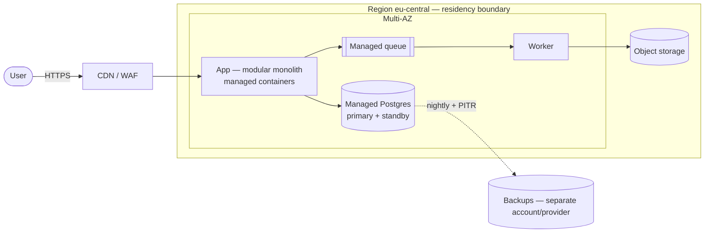

# Templates — cloud-architecture

## 1. Design doc skeleton (`output/<YYYYMMDD>-<slug>-architecture.md`)

```markdown
# <System> — Architecture (<Design|Review|Move>) · <date>

## TL;DR
- Recommendation in one line · monthly run cost + unit cost · SLO achieved · exit target
- Top 3 risks

## 1. Outcome & constraints
Business outcome · cost of 1h downtime · team size/skills · deadline · regulatory class

## 2. Quality-attribute scenarios (ranked, ≤8)
| # | Attribute | Source | Stimulus | Environment | Response | Measure | Given/Assumed |
|---|---|---|---|---|---|---|---|

## 3. Workload classification
Load shape (steady/peak/growth) · state · data gravity + egress GB/month · regulation · AI/GPU

## 4. Architecture views
### C4 L1 — Context   (mermaid)
### C4 L2 — Containers (mermaid; mark trust boundaries, regions/AZs, residency boundary)

## 5. Decisions (ADRs) — summary table, full ADRs in appendix
| ADR | Decision | Rejected alternative | Triggering requirement |
|---|---|---|---|

## 6. Reliability
| Journey | SLO | Serial components (SLA) | Composite | Achievable? |
|---|---|---|---|---|
DR tier · RTO/RPO · cost multiple · control-plane dependencies & static-stability notes

## 7. Cost model (prices dated + sourced)
| Line | Steady/mo | Peak/mo | Driver | Price source (date) |
|---|---|---|---|---|
| Compute | | | | |
| Storage | | | | |
| Egress (internet) | | | | |
| Cross-AZ / NAT | | | | |
| Managed-service premium | | | | |
| Observability / logs | | | | |
| Non-prod | | | | |
| **Total** | | | | |
Unit cost: € per <tenant|txn|user> · commitment plan + lock-in tradeoff · (Move) 3-yr TCO + break-even

## 8. Exit & sovereignty
| Component | Portability (portable/rewrite/accepted lock-in) | Exit equivalent | Reason |
|---|---|---|---|
Exit target · data export path (volume × price) · Data Act / DORA hooks · jurisdiction / CLOUD Act exposure · sovereignty type needed (residency / operational / technological)

## 9. Risks (ranked)
| Risk | Likelihood | Impact | Mitigation | Owner |
|---|---|---|---|---|

## 10. Open questions (every Assumed scenario lands here)

## Appendix — full ADRs · Evidence (sources + retrieval dates)
```

## 2. ADR (MADR-lite)

```markdown
# ADR-<n>: <decision in imperative, e.g. "Use managed Postgres as system of record">
- Status: proposed | accepted | superseded by ADR-<m>
- Date: <YYYY-MM-DD>
## Context
The requirement(s) / scenario #s forcing a decision. Facts, with numbers.
## Decision
What we do.
## Alternatives considered
- <Alt A> — rejected because <measured reason tied to a scenario>
- <Alt B> — rejected because ...
## Consequences
+ what gets easier · − what gets harder / costs more · exit impact (portable | rewrite | accepted lock-in)
## Revisit when
The observable trigger that reopens this (e.g. "> 5 teams deploying independently", "write load > 20k TPS").
```

## 3. Review-mode findings table

```markdown
| # | Severity (Critical/High/Med/Low) | Finding | Evidence (file:line / bill line / diagram element) | Fix | Effort (S/M/L) | Pillar |
|---|---|---|---|---|---|---|
```
Severity anchors: **Critical** = data loss, security breach, or an unmet regulatory obligation is plausible · **High** = SLO or budget will be missed at the stated load · **Med** = avoidable cost/ops burden · **Low** = hygiene.

## 4. Mermaid C4 starter


